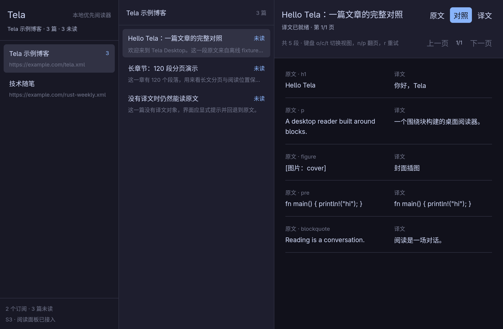

# Tela Desktop

A desktop reader for [Tela](https://telaread.com) (Rust + [GPUI Kit](https://github.com/longbridge/gpui-kit)).

English | [简体中文](./README.md)

> **Current status**: **The real API v1 foundation is wired up** — OAuth 2.1 + PKCE login, refresh
> tokens stored in the OS credential store, full/incremental sync, an offline mutation queue,
> local-first reading of bodies/translations/images, one-click per-subscription offline caching,
> article recommendations and "My Recommendations", automatic pause of translation polling when
> offline, a terminal CLI, and an offline GUI demo.
> The protocol follows the official [authorization.md](https://github.com/hutusi/tela/blob/main/docs/api/authorization.md)
> and [v1.md](https://github.com/hutusi/tela/blob/main/docs/api/v1.md) (read in full on 2026-10-28).
> See [`docs/real-api.md`](./docs/real-api.md) for implementation details.

## Quick start (real API)

Prerequisite: register a public native client with Tela and set its redirect URI to
`http://127.0.0.1/callback` (no port; any free port is used at runtime).

```bash
export TELA_CLIENT_ID=tela_app_…
# If you need the email: export TELA_SCOPES="write email"

cargo run -p tela-app -- login          # open the system browser, receive the auth code on a loopback port
cargo run -p tela-app -- sync           # push the offline queue, then pull the latest data
cargo run -p tela-app -- list           # subscriptions + unread counts
cargo run -p tela-app -- list --feed 1  # articles under one subscription
cargo run -p tela-app -- read 101       # read (marks as read on open; --no-mark-read disables it)
cargo run -p tela-app -- mark-read 101  # mark as read (queued offline and pushed immediately)
cargo run -p tela-app -- mark-unread 101
cargo run -p tela-app -- like 101       # like; --unlike removes it
cargo run -p tela-app -- status         # cursor, row counts, pending queue, cache counts, today's quota
cargo run -p tela-app -- logout         # revoke this device's token and clear local account data
```

The offline demo runs without any environment variables:

```bash
cargo run -p tela-app                    # opens the in-process mock side-by-side reader by default
cargo run -p tela-app -- demo --chapter mock-long
```

`tela-app --help` lists every subcommand; `status --offline` never touches the network.

### Environment variables

| Variable | Default | Description |
|---|---|---|
| `TELA_CLIENT_ID` | Built in at build time | Release packages already embed the public client id; local builds/debugging can override it |
| `TELA_SCOPES` | `write` | `read` / `write`, optionally with `email`; a `read` token cannot mark as read or like |
| `TELA_API_BASE_URL` | `https://api.telaread.com` | API base URL |
| `TELA_AUTH_BASE_URL` | `https://telaread.com` | Authorization site |
| `TELA_DB` | See below | SQLite path |
| `TELA_LANG` | `zh-Hans` | Default translation language for the GUI wiring; the CLI uses the global `--lang` (defaults to `zh-Hans`) |
| `TELA_TOKEN_STORE` | `keyring` | `memory` / `ephemeral` are only for tests or temporary sessions; they expire on exit |
| `TELA_DEMO` | (unset) | The GUI uses the real API (login mode) by default; `1`/`true`/`yes`/`on` enters demo mode |
| `TELA_DEV_SEED` | (unset) | Whether demo wiring seeds demo data when the DB is empty; `0` disables it |

The default `TELA_DB` path is platform-specific: `$XDG_DATA_HOME/tela/tela.db` (when
`XDG_DATA_HOME` is set); `%APPDATA%\tela\tela.db` on Windows; otherwise
`$HOME/.local/share/tela/tela.db`.

## Terminal CLI

`tela-app --help` is the authoritative usage reference; every subcommand accepts three global options:

| Option | Default | Description |
|---|---|---|
| `--lang` | `zh-Hans` | Translation language: `zh-Hans` / `zh-Hant` / `en` / `fr` |
| `--view` | `compare` | Reading view: `original` / `compare` / `translation` |
| `--page-size` | `20` | Paragraphs per page |

| Subcommand | Common options | Description |
|---|---|---|
| `login` | `--no-browser` / `--ephemeral` | Browser authorization; do not auto-open the browser, or keep the refresh token in memory only |
| `logout` | — | Revoke the device token and clear local account data (body/translation/image caches are kept) |
| `sync` | `--full` / `--types articles,states` | Push the offline queue, then pull; `--full` drops the cursor and starts over |
| `list` | `--feed <id>` / `--unread` | List subscriptions; or list one subscription's articles, unread only |
| `read <id>` | `--translate` / `--no-mark-read` | Read an article; optionally request translation first, or disable mark-as-read on open |
| `mark-read <id>` | — | Mark as read (queued and pushed immediately) |
| `mark-unread <id>` | — | Mark as unread |
| `like <id>` | `--unlike` | Like / unlike |
| `status` | `--offline` | Local cursor, row counts, pending queue, body/translation/image cache counts; adds quota when online |
| `meta` | — | Read server capabilities and limits anonymously |
| `demo` | `--chapter <key>` | Offline demo reader; needs no account or network |

Running without a subcommand is equivalent to `demo`. The interactive reader supports: `n`/`next`
next page, `p`/`prev` previous page, `r`/`retry` retry, `o`/`original` original text, `c`/`compare`
side-by-side, `t`/`translation` translation, `q` quit.

`demo --chapter` accepts a body key as well as scenario aliases:

- `mock` / `normal` / `mock-normal`
- `mock-long` / `long`
- `mock-empty` / `empty`
- `mock-partial` / `partial`
- `mock-no-translation` / `no-translation` / `untranslated`

## Build and test

Prerequisites: Rust stable (verified locally with `rustc 1.98.1` / `cargo 1.98.1`; the workspace
declares `rust-version = "1.92"`). `reqwest` uses rustls (aws-lc-rs), so the first build needs
`cmake` and a C compiler; Linux also needs `pkg-config`.

```bash
cargo build --workspace --locked                          # build
cargo test --workspace --locked                           # all tests (including real API fixture contracts)
cargo run -p tela-app -- --version                        # tela-app 0.4.2
cargo fmt --all --check
cargo clippy --workspace --all-targets -- -D warnings
```

These 5 commands map one-to-one to CI ([`.github/workflows/ci.yml`](./.github/workflows/ci.yml)).

Online smoke test of the real API (no token needed):

```bash
TELA_TOKEN_STORE=memory TELA_DB=tmp/smoke.db cargo run -p tela-app -- meta
```

## GUI

GUI dependencies are **not compiled by default**: `tela-gui` requires an explicit `--features gui`,
so machines without Wayland/Vulkan system libraries can still run the default checks above.

```bash
# Default: real API (login mode). When logged out the sidebar shows "Sign in to Tela"; after
# signing in it syncs automatically
cargo run -p tela-app --features gui --bin tela-gui --locked

# Demo data (no account needed): --demo; an empty DB is seeded with 2 subscriptions / 4 articles
TELA_DB=target/tela-gui.db \
  cargo run -p tela-app --features gui --bin tela-gui --locked -- --demo

# Local debugging against the real API: temporarily override client id / DB path
source tmp/tela.env                 # local client id / DB path (not committed)
cargo run -p tela-app --features gui --bin tela-gui --locked
scripts/tela-gui-real.sh --check    # headless data smoke test (reads tmp/tela.env + real wiring)
```

Release builds compile the public client id into the binary (`.github/workflows/release.yml`
injects it from the `TELA_CLIENT_ID` repository variable), so unpacked users start in login mode by
default; the `TELA_CLIENT_ID` environment variable can still override it.

### Window and layout

- Default window 1100×720, minimum 880×560; titled `Tela Desktop`, and closing the last window quits the app.
- Three columns: subscription list on the left (260 px), the current subscription's articles or "My Recommendations" in the middle (340–360 px), and the reading panel on the right (responsive).
- The top-left is the "TelaRead" brand; clicking it opens <https://telaread.com> in the system browser. Below it is the current subscription status.
- Above the subscription list is the "My Recommendations" entry, showing the number of recommended articles; clicking it switches to the recommendations list.
- Each subscription row shows its title, unread count, feed URL and a "Cache" button; the selected row is highlighted, and clicking anywhere on the row switches subscription.
- The middle list header shows the current subscription title and article count; each article shows its title, unread marker, publish date and summary.
- The bottom of the sidebar shows the subscription count, total unread count and the account panel.
- Empty subscriptions and list load failures show the corresponding empty/error state; failing to open the TelaRead homepage also shows a notice in the sidebar.
- In real login mode, selecting an article or switching subscriptions (which automatically shows the first article) marks it as read immediately: local state changes first, then the change is pushed in the background; controlled by `reader.mark_on_open`.

### Reading panel

- With no article selected it shows "Select an article to start reading"; empty chapters, loading and load failures each have their own state page.
- The `↗` next to the title opens the original article in the system browser; a failure is shown below the title.
- The top shows the translation status (ready / translating / partially missing / no translation yet) and the total paragraph count, with three view buttons on the right: `Original | Compare | Translation`; there are no page numbers and no "Previous / Next" buttons.
- The compare view aligns original and translation block by block side by side; blocks without a translation fall back to the original text, and the status reports the number of missing paragraphs.
- The body renders block-level HTML (headings, quotes, lists, tables, links, code blocks, images); text is selectable.
- The whole article is rendered at once and scrolls continuously: hold `PgDn` or `↓` to read all the way to the end, which is marked with "— End of article —"; `PgUp` / `↑` scroll back up without jumping at page boundaries or resetting the position.
- Without a translation it automatically requests one from the server and polls; once available it is written back to the local cache and later opens no longer request it. When today's quota is exhausted or the author has disabled translation, a notice appears below the title and the original text keeps showing.
- Switching views keeps the current reading position; load failures show error details and a "Retry" button, and the `r` shortcut does the same.

### Recommendations

- The "Recommend" button next to the reading panel title opens a modal: optionally write a note (up to 500 characters) and submit; for an already recommended article the button shows "Recommended", and reopening it lets you edit the note or "Remove recommendation".
- A recommendation is first written to the local DB and entered into the offline queue, so the UI updates immediately; a sync is then attempted automatically, and the queue is kept if the network fails.
- "My Recommendations" lists all non-withdrawn recommendations in reverse chronological order, showing article title, blog, date and note; clicking an entry opens the article, and "Remove" on the right can also withdraw the recommendation.
- Recommending and withdrawing both require the `write` scope; with a read-only token the modal stays open with a clear error and never pretends to succeed.
- Real recommendation rows come from `/v1/sync`; changes made on the web or another device appear in the list after the next sync.

### Offline cache and loading strategy

- **Local first**: bodies, translations and images are written to SQLite after the first successful fetch; opening the same article later reads the cached body, translation and images directly, without calling `/v1/bodies`, `/v1/translations` or `/img/…` again.
- There is a "Cache" button to the right of each blog name: one click caches all uncached bodies, translations and images for that subscription in the background. The button shows `3/12`, `Cached`, `N pending` (translations still being generated) or `Retry` (failure / images incomplete); caching runs in the background without blocking reading, does not switch subscriptions as a side effect, and start/finish/failure notices appear at the top of the sidebar.
- Batch caching skips articles that are already complete; even if an article's body/translation are cached, it still fills in any missing images.
- **Automatic offline detection**: after a network-layer request fails (`TelaError::Net`) the app marks itself offline and the reading panel pauses translation polling, no longer repeatedly requesting `/v1/translations/...`; while waiting for a translation it only performs a lightweight `GET /meta` liveness check about every 10 seconds, and resumes automatically when the network returns.
- Offline, cached bodies, translations and images remain readable as usual; uncached images are filled in the next time the article is opened online or "Cache" is clicked again. Clicking "Cache" while offline first checks liveness, and if it still fails it reports failure quickly instead of timing out per article.
- The cache is not tied to the current account: signing out or switching accounts never deletes body/translation/image caches.

### Account and login

- In real mode when logged out, the bottom of the sidebar shows "Sign in to Tela"; clicking it opens a browser to complete OAuth authorization.
- While waiting for authorization it shows the authorization URL with "Open authorization page / Copy link / Cancel"; if authorization fails you can "Retry sign-in".
- When logged in it shows `@handle` and the scope, plus the local DB path, and offers "Sign out".
- With a read-only (`read` scope) token the GUI never attempts mark-as-read or write operations; the CLI's write commands require the `write` scope and work again after re-authorization.
- After a successful sign-in it syncs and refreshes the list automatically; when already logged in at startup it also syncs once first (if the network fails it keeps reading the local DB).
- If the credential store is unavailable (Keychain / Secret Service locked, etc.) the reason is shown in the sidebar and reading local caches is unaffected.
- If `TELA_CLIENT_ID` is missing, the sidebar says so and the startup sync is skipped; set it and restart to sign in.

### Keyboard shortcuts and mouse

- Global: `j` / `k` next / previous article; `Shift+J` / `Shift+K` next / previous blog.
- Reading: `o` original, `c` compare, `t` translation, `↑` / `↓` scroll line by line, `PgUp` / `PgDn` scroll by viewport (one continuous article, no page switching), `r` retry.
- Mouse: click a subscription/article to switch, scroll wheel to scroll, body text selectable.

### Demo mode

- `--demo` or `TELA_DEMO=1` uses the in-process mock, requiring no account or network.
- An empty DB is seeded with 2 subscriptions and 4 articles (normal / long chapter / no translation / already read), covering the three views, long-article continuous scrolling, fallback without translation and the read state; `TELA_DEV_SEED=0` disables seeding.
- The demo data also includes 1 recommendation so you can inspect the "My Recommendations" list directly; demo mode has no account, so recommending/withdrawing shows that sign-in is required (write operations never hit the DB).

### Current limitations

- The UI is fixed to a dark theme; there is no font-size / line-width / theme settings page.
- Only per-subscription article lists exist; there are no cross-subscription Unread / Today / Liked views.
- There is no periodic background sync; currently it syncs once at startup and again after sign-in, mark-as-read and similar actions.
- There is no search, Discover, folders, highlights/notes, OPML or auto-update entry point.
- Recommendations are only managed in "My Recommendations"; there is no member profile or public recommendations page.
- The cache has no size limit, usage statistics or cleanup entry point; for now you can only delete the local DB file manually.
- Images only parse ``, not `srcset` / `<picture>`.

```bash
# GUI tests (headless; no DISPLAY/WAYLAND_DISPLAY needed)
env -u DISPLAY -u WAYLAND_DISPLAY \
  cargo test -p tela-ui --features gui-test --locked

# Headless data-path smoke test (used by CI)
TELA_DB=target/ci-gui.db TELA_DEV_SEED=1 \
  cargo run -p tela-app --features gui --bin tela-gui --locked -- --check
# → tela-gui check: feeds=2 articles=4 unread=3
```



More screenshots and per-item acceptance commands are in [`docs/gui_acceptance.md`](./docs/gui_acceptance.md).

## Local cache and offline data

SQLite uses schema v4 (opening an older DB only adds tables and never loses existing data):

| Table | Contents |
|---|---|
| `meta` | Schema version, sync cursor, language, row types, account handle |
| `sync_rows` | Sync rows for subscriptions/articles/titles/states, stored as wire JSON by `(entity, row_key)` |
| `pending_mutations` | Offline write queue: `mid` + `at` + mutation JSON |
| `bodies` | `contentKey` → immutable body object JSON |
| `cached_translations` | `(contentKey, lang)` → translation status + readable translation object JSON (including pending/none snapshots) |
| `cached_images` | Image URL → raw bytes BLOB |

- Opening an article reads local data first; only requests `/v1/bodies` when the body is missing, and checks translation status only when there is no translation snapshot.
- Without a translation it sends `POST /v1/translations` on demand and polls in the background; once complete it writes to the cache.
- Images are downloaded with authentication via `ContentApi::load_image`, and the bytes are written to `cached_images`; the reading panel only caches decoded `Image` objects in memory, relying on SQLite across processes.
- Signing out / switching accounts clears sync rows and the pending queue but keeps `bodies` / `cached_translations` / `cached_images` (their content contains no account-private data); the snapshot reset from `sync --full` also leaves these caches untouched.
- There is currently no cache size limit, usage statistics or cleanup command; delete the DB file that `TELA_DB` points to when needed.

See [`docs/real-api.md`](./docs/real-api.md) for detailed fields and migration notes.

## Architecture

Dependencies flow in one direction: `tela-app → {tela-ui, tela-sync} → {tela-store, tela-content, tela-net} → tela-proto`.

| Path | Responsibility |
|---|---|
| `crates/tela-proto` | v1 wire types (14 sync tables, 17 mutation kinds, me/usage/meta), errors, read rules |
| `crates/tela-store` | SQLite schema v4: rows, opaque cursor, offline queue, body/translation/image caches |
| `crates/tela-sync` | Pull orchestration (reset/more/retry), push queue, state snapshots |
| `crates/tela-net` | OAuth PKCE, loopback callback, OS credential store, Bearer client, error mapping |
| `crates/tela-content` | Body/translation models, `/v1/bodies`, translation status and objects, image byte interface |
| `crates/tela-ui` | Pure view models (`shell`/`reader/*`) + GPUI views (`gui/*`) |
| `crates/tela-app` | Wiring (`services.rs`), local cache layer (`content_cache.rs`), terminal CLI, GPUI entry point |
| `tests/fixtures/api/` | Official v1 sample response bodies (sync/mutations/me/usage/meta/translation) |
| `tests/fixtures/content/` | Body and translation object fixtures (including image URLs) |

### Key semantics

- **The cursor is opaque**: it is persisted in the same transaction as the rows; when changing language or row type the client deliberately starts over from a snapshot.
- **Offline queue**: `pending_mutations` persists `mid` and `at` across processes; failures are resent as-is, and the whole batch is dropped once there is a response.
- **Read state**: determined by the documented 5-level priority (`readAt` → `markedUnread` → watermark → 30 days → unread).
- **Tokens**: the access token lives only in memory; the refresh token goes only into Keychain / Credential Manager / Secret Service.
- **Bodies**: immutable objects cached by `contentKey` in the `bodies` table, re-readable offline.
- **Translations and images**: cached by `(contentKey, lang)` and image URL respectively; readable offline after the first load, and the batch cache button prefetches translations and images together.
- **Offline detection**: a failed request marks the app offline; offline it pauses translation polling and only does a low-frequency `/meta` liveness check, resuming automatically when the network returns, with no manual switch.

See [`docs/real-api.md`](./docs/real-api.md) for a fuller interface mapping, error codes and security notes.

## Release

Releases are automated by [`release.yml`](./.github/workflows/release.yml):

```bash
# after removing the v prefix, the tag must equal tela-app's version in Cargo.toml
# the TELA_CLIENT_ID repository variable must be configured before building (release packages embed it)
git tag -a v0.4.2 -m "Tela Desktop v0.4.2"
git push origin v0.4.2
```

After pushing the tag:

1. Validate the tag/version and run the full test suite on Linux;
2. Build `tela-app` and `tela-gui` natively on `ubuntu-24.04`, `windows-latest`, `macos-15` (Apple Silicon) and `macos-15-intel` (Intel);
3. Produce
   `tela-desktop-<tag>-x86_64-unknown-linux-gnu.tar.gz`,
   `tela-desktop-<tag>-x86_64-pc-windows-msvc.zip`,
   `tela-desktop-<tag>-aarch64-apple-darwin.tar.gz`,
   `tela-desktop-<tag>-x86_64-apple-darwin.tar.gz` and the corresponding `.sha256` files;
4. Create the GitHub Release (with auto-generated release notes).

Pre-releases use a hyphenated tag and are automatically marked as prerelease:

```bash
git tag -a v0.4.2-rc.1 -m "Tela Desktop v0.4.2-rc.1"
git push origin v0.4.2-rc.1
```

The Linux GUI depends on Wayland/Vulkan/font system libraries; the Windows package is a native
MSVC build; macOS ships both Apple Silicon and Intel native packages, but they are **unsigned and
not notarized**. If Gatekeeper blocks the first run, run this in the unpacked directory:

```bash
xattr -dr com.apple.quarantine .
./tela-gui
```

### The Windows package is "unpack and run"

The Windows exe statically links the MSVC/C runtime (see `crt-static` in
[`.cargo/config.toml`](./.cargo/config.toml)), so after unpacking you can just double-click
`tela-gui.exe`; there is **no need** to install the Visual C++ Redistributable separately.
Before packaging, `release.yml` scans both exes' import tables and fails the build if
`VCRUNTIME140.dll` / `MSVCP140.dll` are reintroduced.

Double-clicking starts in **login mode** (the release package embeds the public client id): click
"Sign in to Tela" at the bottom of the sidebar, complete authorization in the browser, and the token
goes into Windows Credential Manager while data lands in `%APPDATA%\tela\tela.db`.
To browse demo data offline, use `tela-gui.exe --demo`.

> A failed startup has no console output; the reason is written to `%APPDATA%\tela\tela-gui-error.log`.

> **The v0.2.0 Windows package did not use a static CRT**: double-clicking it reports
> `VCRUNTIME140.dll was not found`. Use v0.2.1 or later instead.

## Documentation

| Document | Contents |
|---|---|
| [Real API integration](./docs/real-api.md) | OAuth, sync/push, bodies/translation, exit codes, tests and next steps |
| [Remaining work inventory](./docs/remaining-work.md) | Per-item status against M0–M5 and P0/P1, estimates and the next batch of slices |
| [API proposal (historical)](./docs/api-proposal.md) | Research and proposal before the public server API; the official v1 docs are authoritative |
| [Architecture design](./docs/architecture.md) | Processes/threads, crate layout, SQLite, sync/reducer, rendering pipeline |
| [Product design](./docs/product-design.md) | Target users, feature scope, key screens, roadmap |
| [Development plan](./docs/development_plan.md) | Phases/slices, interface contracts, acceptance commands |
| [GUI acceptance](./docs/gui_acceptance.md) | S0–S4 deliverables, verified commands, screenshots |

## Research baseline

- `hutusi/tela` @ `f57fa6f` (2026-10-25); API docs read in full on 2026-10-28
- `longbridge/gpui-kit` @ `7b14e03` (`gpui-kit 0.8.0`, GPUI snapshot `gpui-pre 0.3.9`)

## Next steps

1. Periodic sync and automatic list refresh in the GUI (a sync round already runs before the window opens; `AppServices::sync_once` is reusable);
2. Unread / Today / Liked lists and "mark all read + undo";
3. UI for highlights, folders, following and OPML;
4. Discover / sites / profiles / search (public read-only; `lang` is mandatory);
5. Cache management (size limit, usage statistics, cleanup entry point), a reading settings page (font size/theme) and auto-update.

## Disclaimer

This is a personal/community project and is not affiliated with Tela. Use of the name, icons and
content requires the author's permission.

## License

The code is released under the dual **MIT OR Apache-2.0** license, see `LICENSE-MIT` and
`LICENSE-APACHE`. Tela's name, icons and content are not covered by this license and require the
author's permission to use.
