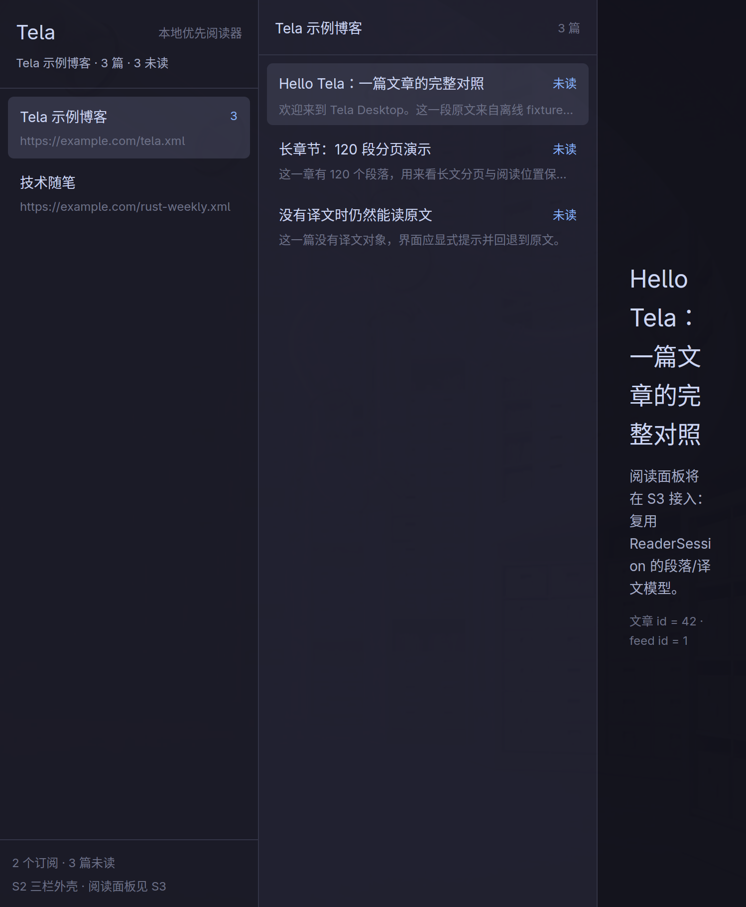
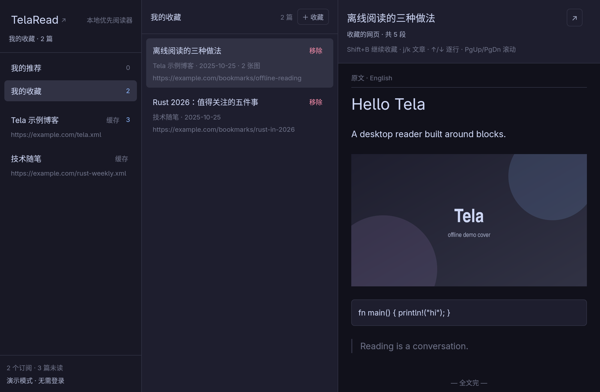
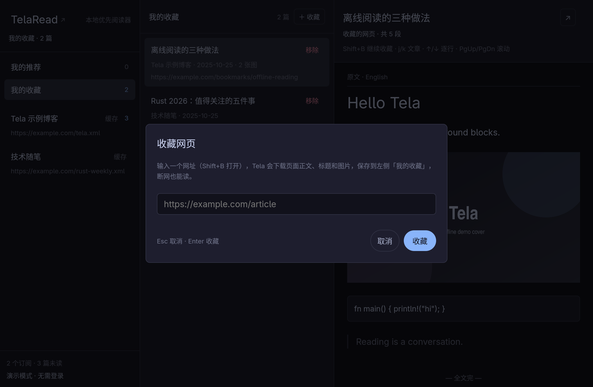

# GUI 宿主验收：S0–S8（M2/M3 的 GUI 补课 + 推荐/网页收藏）

> **2026-11-02 更新（v0.4.3）**：新增 S8「网页收藏」——`Shift+B` 收藏任意网址，
> 正文以 Markdown 存本地（`documents`，schema v6），图片本地缓存，微信/X 站点适配、
> 验证页识别与 Markdown 浏览均已实测。验收命令与数量见下文 S8 段。
>
> **2026-10-28 更新（R1）**：应用装配层已切到真实 API v1（见 [`real-api.md`](./real-api.md)）。
> 2026-10-30 起 GUI **默认真实登录模式**（发布包内置 public client id，`--demo` 或
> `TELA_DEMO=1` 才进 demo）。装配层测试文件由 `tests/services.rs` 改名为
> `tests/services_v2.rs`，断言口径不变（2 订阅 / 4 文章 / 3 未读）。

- 验收日期：**2026-10-27**（CST）；S8 于 **2026-11-02** 复验（v0.4.3）
- 计划依据：[`development_plan.md`](./development_plan.md) §9 M2/M3
- 目标：把 M2 的“三栏视图 + 应用装配”和 M3 的“阅读视图 + 翻译对照”真正接到
  GPUI 宿主上，同时保证默认无 GUI 构建/测试不回归
- 代码路径：`crates/tela-ui/src/{shell.rs,gui/*}`、`crates/tela-app/src/{lib.rs,services.rs,bin/tela-gui.rs}`

## 0. 结论先行

| 验收门类 | 结论 | 证据 |
|---|---|---|
| S0 GPUI 工具链/窗口冒烟 | ✅ | `gui_smoke` 1 passed；真实 Wayland 窗口 + 截图 |
| S1 应用装配层 | ✅ | `tests/services.rs` 8 passed；文件库重开、seed、未读、正文请求 |
| S2 三栏 shell + 订阅列表 + 空态 | ✅ | `shell_view_model` 5 + `gui_shell` 2 passed；截图 |
| S3 文章列表 + 阅读面板 + 交互 | ✅ | `gui_reader` 4 passed；三视图/翻页/失败重试；截图 |
| S4 CI/验收/文档 | ✅（CI 配置已加，未在 GitHub runner 实跑） | `.github/workflows/ci.yml` 的 `gui` job；本文档 |
| 默认无 GUI 构建/测试 | ✅ 不回归 | `cargo test --workspace --locked` → 178 passed / 0 failed / 7 ignored |
| GUI 测试无显示器运行 | ✅ Q-13 已解 | 去掉 `DISPLAY`/`WAYLAND_DISPLAY` 后 59 passed / 0 failed / 2 ignored |

**总结论：Gui demo 已可用——`tela-gui` 打开即为“订阅 / 文章 / 对照阅读”三栏，默认 mock 数据可离线阅读，三种视图与翻页可用；S7 已接上推荐与「我的推荐」；S8 已接上 `Shift+B` 网页收藏与「我的收藏」。M4 其余功能尚未开始。**

## 1. 切片与交付

| 切片 | 交付物 | 关键文件 | 验证 |
|---|---|---|---|
| S0 | `tela-gui` 入口、`gui` feature 门控、窗口启动、GPUI 测试 harness | `tela-ui/src/gui/mod.rs`、`tela-app/src/bin/tela-gui.rs` | `gui_smoke` |
| S1 | `AppServices`：Store + ContentApi + SyncTransport、默认库路径、演示 seed、列表/正文请求、同步入口 | `tela-app/src/lib.rs`、`services.rs` | `tela-app/tests/services_v2.rs` |
| S2 | 纯 `ShellViewModel` + GPUI 三栏 shell、订阅列表、文章列表、空态/错误态 | `tela-ui/src/shell.rs`、`gui/shell.rs` | `shell_view_model`、`gui_shell` |
| S3 | `ReaderView`：后台取数、generation 防旧结果覆盖、三视图、翻页、重试、键盘 | `tela-ui/src/gui/reader.rs`、`reader/session.rs` | `gui_reader` |
| S4 | CI GUI job、无窗口数据冒烟、截图、文档回写 | `.github/workflows/ci.yml`、`docs/gui_acceptance.md` | 下方命令 |
| S5 | 账号面板：登录 / 等待授权（打开/复制/取消）/ 退出；登录后自动同步刷新 | `tela-ui/src/account.rs`、`gui/shell.rs`、`tela-app/src/services.rs` | `gui_account` 3 passed |
| S6 | 列表发表时间、标题旁打开原文、↑/↓ 逐行滚动、TelaRead 主页入口 | `tela-ui/src/{shell.rs,gui/*}`、`tela-net/src/browser.rs` | `shell_view_model`、`gui_reader`、`gui_shell` |
| S7 | 推荐弹窗（推荐语/编辑/撤回）、侧栏「我的推荐」与推荐列表 | `tela-ui/src/{shell.rs,gui/*}`、`tela-app/src/services.rs` | `shell_view_model`、`gui_shell`、`services_v2`、`tela-app --lib` |
| S8 | `Shift+B` 收藏网页弹窗、侧栏「我的收藏」、网页正文/标题/图片落库与阅读 | `tela-content/src/webpage.rs`、`tela-store/src/{schema,store}.rs`、`tela-ui/src/{shell.rs,gui/{shell,bookmark,reader}.rs}`、`tela-app/src/{services,content_cache}.rs` | `webpage`、`store_v2`、`shell_view_model`、`gui_shell`、`services_v2`、截图 |

### S1 关键行为

- `AppConfig::from_env()`：`TELA_DB` > `$XDG_DATA_HOME/tela/tela.db` > `~/.local/share/tela/tela.db`；
  `TELA_LANG` 默认 `zh-Hans`；`TELA_DEV_SEED=0` 可关闭演示数据。
- `seed_demo()`：仅在 `subscriptions` 与 `articles` 都为空时写入，**不会 reset 用户已有库**。
  演示数据 = 2 个订阅 + 4 篇文章（正常 / 120 段长章节 / 无译文 / 已读）。
- `chapter_request_for()` 把 wire 的 `c/<key>.json` 归一化成内容 API 需要的裸 key。
- `sync_once()` 已提供，但 GUI **启动时不自动同步**：当前默认 mock transport 无脚本，
  自动同步只会把订阅标成 error；M4 接真实传输层后再接后台循环。

### S2/S3 关键行为

- 所有列表数据来自 `ShellData` 只读快照；GUI 不写 SQL、不发 HTTP。
- 阅读取数在 `background_executor` 执行；每次加载带 `generation`，快速切换文章时旧结果被丢弃。
- 三视图复用 `ReaderSession` / `ReaderRow`，终端宿主与 GUI 共享同一套语义。
- 快捷键：`o` 原文、`c` 对照、`t` 译文、`n` 下一页、`p` 上一页、`r` 重试；
  `↑`/`↓` 按窗口行高逐行滚动，`PgUp`/`PgDn` 按视口滚动。
- 阅读位置在切视图/翻页时保持一致（`anchor` 不变）。

### S6 列表与阅读体验细节（2026-10-31）

- 中间文章列表在标题下方显示发表时间（UTC 日期）；兼容 wire 的毫秒时间戳与旧 fixture 的秒时间戳。
- 阅读区标题旁的 `↗` 用系统浏览器打开原文；文章没有 `url` 时隐藏入口，打开失败在标题下方提示。
- 左上角品牌文字改为「TelaRead」，点击打开 <https://telaread.com>。
- GUI 与 `tela-net` 共用 `browser::open` 的平台分支（macOS `open` / Windows `rundll32` / Linux `xdg-open`）。

### S7 推荐与「我的推荐」（2026-10-31）

- 阅读面板标题旁新增「推荐 / 已推荐」按钮；点击打开窗口级模态弹窗，可填写推荐语
  （可选，上限 500 字）后提交。已推荐时弹窗预填推荐语，并提供「保存 / 取消推荐」。
- 提交走 `recommend` mutation：先写本地 `recommendations` 行并入离线队列，界面立即生效；
  随后外壳补一次同步。撤回走 `unrecommend`，本地行立即从列表消失。
- 侧栏新增「我的推荐」入口（显示数量）；中间栏切换为推荐列表，按推荐时间倒序显示
  文章标题、博客、日期、推荐语，点击打开文章，行内「取消」撤回推荐。
- 弹窗打开时阅读面板与外壳的 `o/c/t/n/p/j/k` 全部让位给输入框；`Enter` 在输入框内换行，
  在按钮上等同提交，提交失败保留弹窗并显示错误。
- 只读（`read` scope）或 demo 装配下写操作返回明确错误，不伪装成功。
- 验收：`shell_view_model` 9 passed（推荐 section/导航/错误隔离）、`gui_shell` 6 passed
  （推荐列表 + 弹窗 + 取消推荐 + 模态快捷键）、`services_v2` 12 passed、
  `tela-app --lib` 4 passed（本地乐观写入/队列/scope 拒绝）。

### S8 网页收藏与「我的收藏」（2026-11-01）

- 任意界面按 `Shift+B` 打开窗口级模态「收藏网页」弹窗：单行网址输入框（剪贴板里是网址时
  自动预填）、`Esc` 取消、`Enter`/按钮提交；下载期间禁止重复提交并显示「正在下载…」。
- 下载在 `background_executor` 里执行，不阻塞渲染线程：`tela-content::webpage` 用
  `reqwest`（rustls）抓 HTML；正文抽取先走 `dom_smoothie`（Readability.js 的 Rust 移植），
  再用 `html5ever` + `markup5ever_rcdom` 清洗成块，最后用 `htmd`（turndown.js 的移植）
  转成 **Markdown**；阅读时 `tela-content::markdown` 用 `pulldown-cmark` 把 Markdown
  渲染回块 HTML。
  - 标题：Readability 的 title → `og:title` → `<title>` → 正文首个 `h1` → 主机名；
    站点：Readability 的 site_name → `og:site_name` → 主机名；语言同理。
  - 正文容器：`article` / `main` / `[role=main]` / 常见正文 class（取文字最多者，≥200 字），
    否则回退 `<body>`；`script/style/nav/footer/aside/form/...` 整棵丢弃。
  - 块：标题、段落、引用、`pre` 代码（`<pre><code>` 才会输出围栏代码块）、
    `ul`/`ol`（整张列表一个块）、`table`（整表一个块，输出 Markdown 表格）、
    `figure`/`img`（绝对地址）、`dl`。
  - 行内只保留白名单标签（`a/strong/em/code/br/sub/sup/mark/...`），链接与图片改写为绝对
    `http(s)` 地址；`javascript:`、`data:`、事件属性一律丢弃。
  - 站点适配：`mp.weixin.qq.com` 用微信内浏览器 UA（桌面 UA 会 302 到
    `wappoc_appmsgcaptcha` 验证页），正文容器认 `#js_content` / `.rich_media_content`；
    语义明确的容器（`article`/`main`/`#js_content`）不要求“文字够多”兜底。图片同时识别
    `data-src` / `data-original` / `data-lazy-src` 等懒加载属性。
  - 验证页识别：正文很薄（&lt; 600 字）且命中验证页特征（「环境异常」「完成验证后即可继续访问」
    「Just a moment...」等，或重定向到 `wappoc_appmsgcaptcha` 等地址）时返回
    `TelaError::Blocked`，界面显示「要求人工验证」而不是把验证页存成文章。
  - 读取容错：部分站点（含微信）发完正文就断开 TLS，`read_to_end` 会报 unexpected eof；
    读取循环保留已收到的 HTML 前缀继续解析，只在零字节时失败。
  - 不可见节点：`display:none` / `hidden` 的子树整棵跳过（图片检查祖先链）。微信（mdnice 导出）
    在小标题两侧放了 `display:none` 的 `<span>unset</span>` 样式 hack，之前会变成正文里的
    “unsetunset”，现在会被剔除。
  - X（Twitter）帖子：通用抽取只能拿到导航/登录按钮和“作者 on X”标题。`fetch` 识别
    `/<user>/status/<id>` 后改走 `x_post_from_html`：从脚本里的 GraphQL 结果
    `tweet_result_by_rest_id` 解析长推文全文（`note_tweet`）、作者与引用帖；标题取正文第一行
    （≤80 字），正文按空行分段，引用帖作为引用块，页面 UI 文字不进入正文。
- 落库：正文 **Markdown** 写 `documents`（key = `web-` + URL 的 64 位 FNV-1a，
  连同页面语言），图片写 `cached_images`，收藏行写 `bookmarks`（schema v6）。
  图片下载失败不阻断收藏，只记录成功张数；再次收藏同一 URL 复用同一条目并刷新内容
  （保留首次收藏时间）。旧版本写入 `bodies` 的块正文仍可回退读取。
- 收藏**不属于** `/v1/sync`：`clear_account()`（登出/换账号）不清 `bookmarks`，也不需要登录态。
- 阅读：`ReaderView::select_bookmark` 走与文章相同的 `ReaderSession`，但
  `CachingContentApi` 对 `web-` 前缀的正文先读 `documents` 里的 Markdown，用
  `pulldown-cmark` 渲染成块后返回（旧数据回退 `bodies`），不发翻译请求；阅读面板固定原文视图、
  隐藏 `o/c/t`、状态行显示「收藏的网页 · 共 N 段」。图片仍按 Markdown 里的绝对地址从
  `cached_images` 读取，离线可显示。
- 侧栏在「我的推荐」下方新增「我的收藏」入口（显示条数）；中间栏列出标题、站点、日期、
  图片数与网址，行内「移除」删除收藏并清理只被它引用的正文；删除正在阅读的收藏会让阅读面板
  回到空态。
- 验收：`webpage` 15 passed / 3 ignored（真实网络冒烟：普通网页、公众号文章、X 帖子）、
  `markdown`（tela-content lib）14 passed、`store_v2` 19 passed、`shell_view_model` 14 passed、
  `gui_shell` 9 passed（含 `Shift+B` → 输入 → 提交 → 列表/阅读）、
  `services_v2` 17 passed / 4 ignored（真实网络端到端：普通网页、公众号文章、X 帖子、带图页面/图片缓存）、截图 2 张。

## 2. 验收命令与实测结果

运行环境：Linux x86_64（Hyprland/Wayland）、`rustc 1.98.1`、`gpui-kit 0.8.0`
（`gpui-pre 0.3.9`，未升级）。

```bash
# 1) 默认构建/测试（不编译 gpui-kit，保护无 GUI 系统库的机器）
cargo test --workspace --locked
# 实测：178 passed / 0 failed / 7 ignored（真实网络冒烟用例）

# 2) GUI 测试（无头；显式去掉显示环境，证明不依赖显示器）
env -u DISPLAY -u WAYLAND_DISPLAY \
  cargo test -p tela-ui --features gui-test --locked
# 实测：59 passed / 0 failed / 2 ignored（ignored = 截图工具，需 WGPU headless renderer）

# 3) 应用装配 + GUI 数据冒烟
cargo test -p tela-app --features gui --locked
# 实测：39 passed / 0 failed / 4 ignored；其中 gui_check 1 passed

# 4) 真实二进制：开窗 demo
TELA_DB=target/tela-gui.db \
  cargo run -p tela-app --features gui --bin tela-gui --locked

# 5) 无窗口数据链路（CI 用）
TELA_DB=target/ci-gui.db TELA_DEV_SEED=1 \
  cargo run -p tela-app --features gui --bin tela-gui --locked -- --demo --check
# 实测：tela-gui check: mode=demo feeds=2 articles=4 unread=3 recommendations=1 bookmarks=0

# 6) 代码质量
cargo fmt --all --check
cargo clippy --workspace --all-targets -- -D warnings
cargo clippy -p tela-app --features gui --all-targets -- -D warnings
cargo clippy -p tela-ui --features gui-test --all-targets -- -D warnings
# 实测：全部 exit 0

# 7) 本地截图（可选；需要 WGPU headless renderer）
cargo test -p tela-ui --features gui-test --test gui_screenshot -- --ignored --nocapture
```

## 3. 截图

| 阶段 | 截图 |
|---|---|
| S0 启动窗口 |  |
| S2 三栏外壳（真实窗口，被 Hyprland 平铺成窄窗） |  |
| S3 三栏 + 对照阅读（1100×720 headless 渲染） |  |
| S8 「我的收藏」+ 收藏的网页阅读 |  |
| S8 `Shift+B` 收藏网页弹窗 |  |

S3 截图由 `gui_screenshot` 用 GPUI `HeadlessAppContext` + WGPU 渲染，和真实窗口共用
同一套 `ShellView`/`ReaderView` 代码，不依赖显示器。

## 4. 关键工程决策（含踩坑记录）

1. **GUI 依赖默认不编译**：`tela-ui/gui`、`tela-app/gui` 两把 feature 锁；`tela-gui`
   二进制 `required-features = ["gui"]`。默认 `cargo test --workspace` 不装 Wayland/Vulkan
   头文件也能跑。
2. **`gpui-kit/test-support` 在 0.8.0 上不可用（依赖解析缺陷）**：该 feature 引用
   `gpui-fast?/test-support` 与 `gpui-fast-platform?/test-support`，Cargo 会把 gpui-fast
   0.1.10 拉进依赖图；它与 gpui-pre 0.3.9 对 `cocoa` / `unicode-properties` 的精确版本
   互斥（实测解析失败）。因此 GUI 测试直接用 `gpui` 的 `test-support`（提供
   `TestAppContext` / `#[gpui::test]` / `HeadlessAppContext`），不启用 gpui-kit 的测试
   feature；元素级查询的缺失由纯视图模型测试 + 截图补足。
3. **GUI 测试无头**：`#[gpui::test]` 不创建真实窗口；截图测试显式使用
   `HeadlessAppContext`。本机在 `env -u DISPLAY -u WAYLAND_DISPLAY` 下 43 passed，
   回答了计划 Q-13。
4. **不阻塞渲染线程**：正文 `ContentApi` 是同步 trait，GUI 在
   `background_executor().spawn` 里调用，完成后回实体更新；本地 SQLite/列表读取在首帧
   同步完成（微秒级），没有跨帧持锁。
5. **演示数据只在空库 + mock 后端写入**：避免把用户库 reset；真实 API 模式默认不 seed。

## 5. 已知限制（不按已完成计）

| # | 限制 | 影响 | 后续 |
|---|---|---|---|
| 1 | 真实正文/译本已接入（R1），但未做图片与流式分块 | 图片文章只有文字占位；译文要等整篇完成 | M3/M4 补 `/img/…` 与 `/o/tc/…` |
| 2 | 无周期同步；GUI 只在开窗前同步一轮，登录后同步一次 | 长时间开着窗口不会自动刷新 | 接后台定时器 + 列表刷新 |
| 2b | 已实现打开文章自动 `markRead`（GUI 选中 / CLI `read`，尊重 `reader.mark_on_open`）；仍缺「全部已读 + 撤销」 | 批量清零未读需要逐条操作 | M4 接 `markAllRead` + Undo |
| 3 | 无正文图片下载/渲染（图片块是占位文案） | 图片文章只有文字占位 | M3/M5 |
| 4 | 无 `insta` 快照；用行为断言 + headless 截图替代 | 视觉回归没有像素级门禁 | 后续可加 |
| 5 | CI 的 `gui` job 未在 GitHub runner 实跑 | 不能声称远端绿 | 首次 push 后看 runner 结果 |
| 6 | macOS/Windows 未验证 | 只在 Linux/Wayland 实测 | 打包前补 |
| 7 | 截图测试默认 `#[ignore]`（需要 GPU） | CI 不跑像素 | 需要时本地 `--ignored` |

## 6. Q-13 结论

**可以。** GPUI 的 `test-support` 在无 `DISPLAY`/`WAYLAND_DISPLAY` 下可创建窗口、渲染帧、
查询实体状态；截图需要 headless WGPU（本机可用）。因此计划里“UI 测试必须显示器”的
风险不成立，CI 不需要 Xvfb，但仍需安装 gpui-kit 的 Linux 构建头文件。

## 7. 下一步（M4）

按计划 §9 M4 推进前，先确认两件事：

1. 真实服务端 API（至少 `HttpContentApi`）可用，否则 GUI 只能停在 mock；
2. 把 `AppServices::sync_once()` 接到后台循环 + 订阅列表刷新（本切片的
   `ShellView::reload()` 已留好入口）。

然后按 M4 的顺序做：F6 → 搜索 → 高亮/文件夹/OPML/离线状态。
